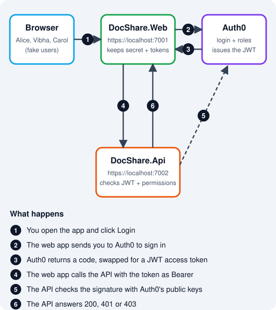

# Episode 1: AuthN vs AuthZ, OIDC, JWT, Auth0 + .NET basics

This episode builds the start of **DocShare**, a small document-sharing API with synthetic data (fake orgs Acme and Globex, fake users and documents). You will log in with Auth0, get a JWT access token, and have a .NET API accept or refuse requests based on the permissions in that token.

**What you need**
- A free [Auth0](https://auth0.com) account
- The .NET 10 SDK (check with `dotnet --list-sdks`)
- An editor such as JetBrains Rider or VS Code
- Docker Desktop (optional, only for Part 5)
- Basic knowledge of OAuth (what a token is)



Click a part below to expand or collapse it.

---

<details>
<summary><strong>Part 1: Concept</strong></summary>

### AuthN vs AuthZ

| | AuthN (authentication) | AuthZ (authorization) |
|---|---|---|
| Question | Who are you? | What may you do? |
| Standard | OpenID Connect (OIDC) | OAuth 2.0 |
| Token | ID token | Access token |
| Who reads it | The client app | The API |
| DocShare example | Carol logs in | Carol (viewer) may `read:documents` but not `share:documents` |

OIDC is a thin identity layer on top of OAuth 2.0. OAuth alone says what a token can do. OIDC adds who the user is.

### The flow (Authorization Code + PKCE)

The same flow as the diagram at the top, in more detail:

```
Browser       DocShare.Web        Auth0        DocShare.Api
   |  1. open app    |                |               |
   |---------------->|                |               |
   |  2. redirect to Auth0 login      |               |
   |<----------------|                |               |
   |  3. log in (Alice)               |               |
   |--------------------------------->|               |
   |  4. redirect back with ?code=    |               |
   |<---------------------------------|               |
   |  5. send code   |                |               |
   |---------------->|                |               |
   |                 |  6. code in, ID + access token out
   |                 |<-------------->|               |
   |                 |  7. GET /documents + Bearer token
   |                 |------------------------------->|
   |                 |  8. API validates JWT, checks permission
   |                 |  9. 200 or 403                 |
   |                 |<-------------------------------|
```

- **Web app:** handles the login and stores the tokens.
- **API:** never sees a password. It only validates the access token.

### What a JWT is

A JWT is three base64url parts: `header.payload.signature`. The API checks the signature against Auth0's public keys (JWKS), then trusts the payload.

```json
{
  "iss": "https://<tenant>.auth0.com/",
  "sub": "auth0|abc123",
  "aud": "https://docshare-api",
  "exp": 1760000000,
  "permissions": ["read:documents", "write:documents"]
}
```

| Claim | API checks |
|---|---|
| `iss` | Token came from my tenant |
| `aud` | Token was meant for this API |
| `exp` | Token has not expired |
| `permissions` | Used for authorization |

### How it maps to .NET

Previews only. The real code is in Part 3.

**1. Authentication: validate the JWT**
```csharp
// Why: trust only tokens from our Auth0 tenant and audience
builder.Services.AddAuthentication().AddJwtBearer(o =>
{
    o.Authority = "https://<tenant>/";   // issuer, keys fetched automatically
    o.Audience  = "https://docshare-api";
});
```

**2. Authorization: a policy on a permission**
```csharp
// Why: turns "read:documents" in the token into a reusable rule
options.AddPolicy("read:documents", p =>
    p.RequireClaim("permissions", "read:documents"));
```

**3. Enforce it on an endpoint**
```csharp
// Why: no valid token gives 401, valid token without the permission gives 403
app.MapGet("/documents", () => Results.Ok()).RequireAuthorization("read:documents");
```

### End-to-end example

| Step | Who | What happens |
|---|---|---|
| 1 | Alice (Acme, owner) | Clicks Login in DocShare.Web |
| 2 | Auth0 | Authenticates her, returns ID token and access token |
| 3 | Web app | Calls `GET /documents` with the access token |
| 4 | API | Validates `iss`, `aud`, `exp` and signature |
| 5 | API | Finds `read:documents`, returns **200** |
| 6 | Carol (Globex, viewer) | Same flow, then calls `POST /documents/1/share` |
| 7 | API | No `share:documents` in her token, returns **403** |

| Status | Meaning |
|---|---|
| 401 | Not authenticated: no token, or the token is invalid |
| 403 | Authenticated, but not allowed |

</details>

<details>
<summary><strong>Part 2: Auth0 setup</strong></summary>

Dashboard labels move occasionally, so treat names as a guide. Never commit secrets. The Client Secret goes only into user-secrets.

### Step 1: Tenant

**Why:** the tenant is your private Auth0 space. Every app, API, user and role below lives inside it, and its domain is the address our code talks to.

1. Sign up at auth0.com (free plan).
2. Pick your nearest region. Auth0 generates the tenant name (for example `dev-xxxxxxxx`) and it cannot be changed. It becomes part of your domain.
3. Go to **Settings → General** and set **Friendly Name** to `authseries-dev`. This is only a display label. The code uses the Domain from the Application settings.

### Step 2: Create the API

**Why:** Auth0 needs to know our API exists, for three reasons:
- **Audience:** the identifier `https://docshare-api` becomes the `aud` claim in access tokens. The API rejects tokens meant for another audience.
- **Permissions:** `read:documents` and the others are defined on the API. Without it there is nothing to authorize against.
- **Access token:** if the web app does not ask for this audience, Auth0 returns an opaque token that the API cannot validate. With it, Auth0 issues a signed JWT for our API.

We register two things in Auth0, and they have different jobs:

| Registered in Auth0 | Role | Question it answers |
|---|---|---|
| `DocShare Web` (Step 5) | The client that logs users in | Who is the user? (AuthN) |
| `DocShare API` (this step) | The resource that tokens are issued for | What can the token holder do? (AuthZ) |

1. **Applications → APIs → Create API**.
2. Name: `DocShare API`.
3. Identifier: `https://docshare-api` (the audience, a label and not a real URL).
4. Signing algorithm: RS256. Click **Create**.
5. In the API's **Settings** tab, under RBAC Settings:
   - Turn on **Enable RBAC**.
   - Turn on **Add Permissions in the Access Token**. Without it the `permissions` claim will not appear.
   - Save.

### Step 3: Add permissions

**Why:** permissions are the fine-grained actions the API can check. They end up in the token's `permissions` claim and drive the policies in Part 3.

In the API's **Permissions** tab:

| Permission | Description |
|---|---|
| `read:documents` | Read documents |
| `write:documents` | Create and edit documents |
| `share:documents` | Share documents |

### Step 4: Create roles

**Why:** assigning permissions to every user one by one does not scale. A role bundles permissions, so we assign a role to a user and Auth0 puts the right permissions in their token.

**User Management → Roles → Create Role**. For each role, open **Permissions → Add Permissions**, select `DocShare API` and tick the permissions.

| Role | Permissions |
|---|---|
| viewer | `read:documents` |
| editor | `read:documents`, `write:documents` |
| owner | `read:documents`, `write:documents`, `share:documents` |

### Step 5: Create the web application

**Why:** Auth0 only redirects users back to, and issues tokens to, applications it knows about. Registering `DocShare Web` gives us:
- **Client ID and Secret:** they identify our app to Auth0, so nobody else can impersonate it.
- **Allowed URLs:** the callback and logout URLs are an allow-list. Auth0 refuses to redirect anywhere else, which blocks token theft through fake redirects.
- **Login settings:** it decides which sign-in methods users see (here, username and password).

The web app does the AuthN (logs the user in). The API from Step 2 does the AuthZ. The web app asks for an access token for the API's audience and sends it to the API.

1. **Applications → Applications → Create Application**.
2. Name: `DocShare Web`. Type: **Regular Web Applications**. We use a server-side app, not a SPA: the whole demo stays in C#, the Client Secret lives in user-secrets, and tokens never reach the browser.
3. In **Settings**, enter the URLs below. `DocShare.Web` runs on HTTPS port 7001 (set in its `launchSettings.json`), so these URLs must use that port:

| Field | Value |
|---|---|
| Allowed Callback URLs | `https://localhost:7001/callback` |
| Allowed Logout URLs | `https://localhost:7001/` |
| Allowed Web Origins | `https://localhost:7001` |

4. Save. On the **Connections** tab, make sure Username-Password-Authentication is enabled.
5. Let this app get tokens for the API. Go to **Applications → APIs → DocShare API → Application Access**, find `DocShare Web`, click **Edit**, set **User Access** to **Authorized**, select all three permissions (it should show **3 / 3 permissions granted**) and save. Without this, login fails with "Client is not authorized to access resource server". Granting all three only makes them *available* to the app. Each user still gets just the permissions of their own role.

### Step 6: Create fake users

**Why:** we need people to log in as and to show different access levels. Different roles give different results from the same API, for example Carol (viewer) is refused when she tries to share. Synthetic emails keep real data out of the series.

**User Management → Users → Create User** (default database connection, synthetic emails only). On each user's **Roles** tab, click **Assign Roles**.

| User | Email | Role |
|---|---|---|
| Alice (Acme) | `alice@acme.test` | owner |
| Vibha (Acme) | `vibha@acme.test` | editor |
| Carol (Globex) | `carol@globex.test` | viewer |

### Step 7: Values to copy

**Why:** our code needs to know which tenant, which app and which API to talk to. These values are the link between the Auth0 dashboard and the C# project.

Note these values somewhere private (a notes app is fine). You will use them when you configure the projects. The "Goes to" column shows where each one ends up.

**Which application do I open?** Go to **Applications → Applications**. You will see three entries:

| Entry | Type | Use it? |
|---|---|---|
| Default App | Generic | No. Auth0 creates it automatically. |
| DocShare API | Machine-to-Machine | No. Auth0 creates it automatically when you create the API, for the Test tab. It is not our login app. |
| **DocShare Web** | Regular Web Application | **Yes.** This is the app that logs users in, so its Domain, Client ID and Client Secret are the ones we need. |

Open **DocShare Web → Settings** and copy from the **Basic Information** section:

| Setting | Where to find it | Why we need it | Goes to |
|---|---|---|---|
| Tenant domain | DocShare Web → Settings → Domain | Tells the app where Auth0 lives (login page, token and key URLs) | appsettings |
| Web app client ID | DocShare Web → Settings → Client ID | Identifies our app to Auth0 (public, not a secret) | appsettings |
| Web app client secret | DocShare Web → Settings → Client Secret | Proves to Auth0 that the request really comes from our server | user-secrets only |
| API audience | `https://docshare-api` (the identifier you chose in Step 2, not found in this app) | Says which API the access token is for | appsettings |
| API permissions | `read:documents`, `write:documents`, `share:documents` | Used in policies in Part 3 | The API code |

Domain and Client ID are not secrets, so they are safe to show. The Client Secret never goes in the repo or in chat.

The values go into `appsettings.json` like this (the secret is set with `dotnet user-secrets`). Use your own tenant's values:
```json
{
  "Auth0": {
    "Domain": "<your-tenant>.auth0.com",
    "Audience": "https://docshare-api",
    "ClientId": "<client-id>"
  }
}
```

### Step 8: Sanity check (no code yet)

**Why:** catch setup mistakes now, such as a wrong audience or a missing claim, before they look like code bugs in Part 3.

1. On the API's **Test** tab, copy the sample token.
2. Paste it into jwt.io. Check that `aud` is `https://docshare-api` and `iss` is your tenant.
3. That token comes from a machine-to-machine app, so it only has permissions if you grant them to that app. Tokens for users with roles are tested in Part 4, once login works.

</details>

<details>
<summary><strong>Part 3: Code</strong></summary>

Target: .NET 10 (newest LTS). Two projects in `DocShare.slnx`.

| Project | Role | HTTPS port |
|---|---|---|
| `src/DocShare.Api` | JWT-protected minimal API | 7002 |
| `src/DocShare.Web` | Server-side login client (Regular Web App) | 7001 (matches Auth0 callback URLs) |

Packages: `Microsoft.AspNetCore.Authentication.JwtBearer` (Api), `Auth0.AspNetCore.Authentication` (Web).

### Folder layout

```
DocShare.slnx
src/
  DocShare.Api/
    Program.cs        JWT validation, policies, endpoints
    Documents.cs      in-memory fake documents (Acme, Globex)
    appsettings.json  Auth0 Domain and Audience
  DocShare.Web/
    Program.cs        Auth0 login, claims page, Call API
    appsettings.json  Auth0 Domain, ClientId, Audience, API address
```

Read the code: [DocShare.Api/Program.cs](../../src/DocShare.Api/Program.cs) and [DocShare.Web/Program.cs](../../src/DocShare.Web/Program.cs). Each part has a one-line comment saying why it exists.

In `appsettings.json` of both projects, replace the Domain (and the web app's ClientId) with your own tenant's values from Part 2.

### API endpoints

| Endpoint | Policy | No token | Token without permission |
|---|---|---|---|
| `GET /health` | none (public) | 200 | 200 |
| `GET /documents` | `read:documents` | 401 | 403 |
| `POST /documents` | `write:documents` | 401 | 403 |
| `POST /documents/{id}/share` | `share:documents` | 401 | 403 |

### Web pages

| Page | What it does |
|---|---|
| `/` | Home with login link |
| `/login`, `/logout` | Auth0 login and logout (callback path `/callback`) |
| `/profile` | Shows the logged-in user's claims |
| `/call-api` | Sends the access token to `GET /documents`, shows status and body |

### Client secret (never in a file)

Run once, with your own value from DocShare Web → Settings → Client Secret:

```bash
dotnet user-secrets set "Auth0:ClientSecret" "<your-client-secret>" --project src/DocShare.Web
```

User-secrets are stored outside the repo, so the secret is never committed. Next, Part 4 runs both projects and tests them.

</details>

<details>
<summary><strong>Part 4: Run and test</strong></summary>

### Step 1: Set the client secret

Open a terminal in the repo root. In Rider: **View → Tool Windows → Terminal** (Alt+F12).

```bash
dotnet user-secrets set "Auth0:ClientSecret" "<your-client-secret>" --project src/DocShare.Web
```

Check it was stored (this prints the value, so do not paste the output anywhere):

```bash
dotnet user-secrets list --project src/DocShare.Web
```

**Why:** `DocShare.Web` reads `Auth0:ClientSecret` at start-up. User-secrets are only loaded in the `Development` environment, which the launch profile sets.

### Step 2: Trust the dev certificate (once)

```bash
dotnet dev-certs https --trust
```

### Step 3: Start both projects

Use two terminals, one per project:

```bash
dotnet run --project src/DocShare.Api
```

```bash
dotnet run --project src/DocShare.Web
```

| Project | URL |
|---|---|
| DocShare.Api | https://localhost:7002 |
| DocShare.Web | https://localhost:7001 |

In Rider, open `DocShare.slnx` with **File → Open** (choose to open it as a solution). Then the run configurations `DocShare.Api: https` and `DocShare.Web: https` appear, and you can run each one from the toolbar. If you only opened the folder, Rider shows no run configurations.

### Step 4: Test

| # | Test | Expected |
|---|---|---|
| 1 | `curl https://localhost:7002/health` | `200` and `{"status":"ok"}` |
| 2 | `curl -i https://localhost:7002/documents` (no token) | `401` |
| 3 | Open https://localhost:7001, click **Login**, sign in as `alice@acme.test` | Redirected to `/profile`, claims table shown |
| 4 | Click **Call API** | `200 OK` and the 4 fake documents |
| 5 | Log out, then log in as `carol@globex.test` and click **Call API** | `200 OK` (a viewer has `read:documents`) |

Test 2 proves the API refuses requests without a token. Tests 3 to 5 prove the whole flow: login, access token for the right audience, API accepts it.

### Troubleshooting

| Symptom | Likely cause | Fix |
|---|---|---|
| Auth0 error "callback URL mismatch" | Callback URL in Auth0 does not match the app | Allowed Callback URLs must be exactly `https://localhost:7001/callback` |
| Login fails: "Client is not authorized to access resource server" | `DocShare Web` is not allowed to get tokens for the API | Part 2, Step 5, item 5: set **User Access** to **Authorized** on the API's **Application Access** tab |
| Error about a missing client secret at login | Secret not set, or not running as `Development` | Repeat Step 1 and start with the `https` launch profile |
| Browser warns the certificate is not trusted | Dev certificate not trusted | Repeat Step 2 and restart the browser |
| **Call API** shows `401` | Token audience or domain does not match the API | `Audience` and `Domain` in both `appsettings.json` files must match Auth0 |
| **Call API** shows `401` and the token has no dots (opaque) | Web app did not ask for the API audience | Check `Auth0:Audience` in `DocShare.Web/appsettings.json` |
| **Call API** shows `403` | `permissions` claim missing | In the API settings turn on **Enable RBAC** and **Add Permissions in the Access Token**, and check the user has a role |
| Connection refused to port 7002 | API is not running | Start `DocShare.Api` first |
| "Address already in use" | Another process uses 7001 or 7002 | Stop it, or change the port in `launchSettings.json` and update the Auth0 URLs |

</details>

<details>
<summary><strong>Part 5: Run with Docker Compose</strong></summary>

Runs both projects in containers with one command. Everything stays on your machine, nothing is deployed to the cloud. You need [Docker Desktop](https://www.docker.com/products/docker-desktop/) running.

| | `dotnet run` (Part 4) | Docker Compose (this part) |
|---|---|---|
| Web app | https://localhost:7001 | https://localhost:7001 (same, so Auth0 URLs do not change) |
| API | https://localhost:7002 | http://localhost:7002 (plain HTTP) |
| Client secret from | user-secrets | `deploy/.env` (gitignored) |
| Web finds the API at | `https://localhost:7002` | `http://docshare-api:8080` (service name on the compose network) |

New files in `deploy/`:

```
deploy/
  docker-compose.yml   both services, ports 7001 and 7002
  Dockerfile.api       builds DocShare.Api
  Dockerfile.web       builds DocShare.Web
  .env.example         copy to .env (gitignored)
  certs/               exported dev certificate (gitignored)
```

### Step 1: Export the dev certificate

**Why:** with `dotnet run`, .NET reads the dev certificate straight from Windows, so you never typed a password. A Linux container cannot see the Windows certificate store, so we export the certificate to a file. A `.pfx` file must be protected by a password, so you invent one now. It is not an Auth0 value. It only locks this local file, and any value works (for example `localdev123`).

```bash
dotnet dev-certs https -ep deploy/certs/aspnetapp.pfx -p "localdev123"
```

You can use your own password instead of `localdev123`. The `.pfx` file is gitignored. Remember the password, because Step 2 needs it. The command may print "A valid HTTPS certificate is already present". That is normal, and the file is still written.

### Step 2: Create `deploy/.env`

```bash
cp deploy/.env.example deploy/.env
```

Open `deploy/.env` and set two values:

| Variable | What to put |
|---|---|
| `AUTH0_CLIENT_SECRET` | The same Client Secret you gave to user-secrets (DocShare Web → Settings → Client Secret in Auth0). Containers cannot read your user-secrets, so it is repeated here. |
| `CERT_PASSWORD` | The password from Step 1 (`localdev123` in the example) |

Put each value on its own line, with no quotes and no spaces:

```
AUTH0_CLIENT_SECRET=<your-client-secret>
CERT_PASSWORD=localdev123
```

This file is gitignored. Never commit it.

### Step 3: Start

Stop any `dotnet run` copies first, because they use the same ports.

```bash
docker compose -f deploy/docker-compose.yml up --build
```

Open https://localhost:7001, log in, and click **Call API**. You should see the same `200 OK` as in Part 4. Check the API directly with `curl http://localhost:7002/health`.

Stop everything:

```bash
docker compose -f deploy/docker-compose.yml down
```

### Troubleshooting

| Symptom | Likely cause | Fix |
|---|---|---|
| "required variable ... is missing" | `deploy/.env` not created or incomplete | Repeat Step 2 |
| Web container exits: "certificate data cannot be read with the provided password" | `CERT_PASSWORD` does not exactly match the Step 1 password (often extra text on the same line), or there is no `.pfx` in `deploy/certs` | Make sure `CERT_PASSWORD` is alone on its line in `deploy/.env`, or repeat Step 1 |
| "port is already allocated" | `dotnet run` or another app uses 7001 or 7002 | Stop it |
| **Call API** fails to connect | API container is not running | Check `docker compose -f deploy/docker-compose.yml ps` |
| Cannot connect to the Docker daemon | Docker Desktop is not running | Start Docker Desktop |

</details>
